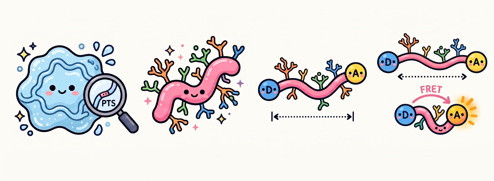

<section class="section">
    <h2 class="accent-title">ABOUT ME</h2>
    

        I’m a PhD student in <a href="https://www.weizmann.ac.il/csb/Fass/home" target="_blank">Prof. Deborah Fass’s lab</a> in the Department of Chemical and Structural Biology at the <a href="https://www.weizmann.ac.il/" target="_blank">Weizmann Institute of Science</a>.
    

    

        My academic path began at Ben-Gurion University of the Negev, where earning my B.Sc. and M.Sc. in Biotechnology Engineering sparked a deep curiosity that led me into structural biology and biophysics.
    

</section>

<section class="section">
    <h2 class="accent-title">MY SCIENCE WORLD</h2>
    

        My doctoral research explores the fascinating world of <strong>mucins</strong>—the heavily glycosylated proteins that form the protective mucus hydrogel barriers in our bodies, as well as protein disulfide mechanisms.
    

    

        Specifically, I investigate how densely packed sugar chains (O-glycosylation) and amino acid sequences shape the structure and conformational dynamics of mucin PTS regions (such as MUC2, MUC5AC, and MUC5B).
    

    

        To look at these molecules up close, I combine <strong>single-molecule FRET (smFRET)</strong> measurements (in collaboration with <a href="https://www.weizmann.ac.il/csb/Hofmann/home" target="_blank">Prof. Hagen Hofmann's group</a>) with structural visualization and computational tools.
    

    

        
    

    

        🔬 smFRET
        🧬 Protein Biophysics
        🐍 Python
        💻 C++
        🧪 PyMOL & ChimeraX
    

    

        <em>Course Goal:</em> My goal for this course is to acquire AI-driven computational tools to analyze quantitative data, enabling me to model and predict peptide behavior based on sequence.
    

</section>

<section class="section">
    <h2 class="accent-title">MY OUTSIDE WORLD</h2>
    

        When I step away from the lab, here is how I love spending my time: CheckCheck!!!
    

    
    

        

            🧘‍♀️
            <h3>Yoga & Mindfulness</h3>
            
Unwinding on the mat to recharge, build strength, and find balance after long days of experiments.

        

        

            📚
            <h3>Reading</h3>
            
Getting lost in a great book whenever I have a quiet moment with a cup of coffee.

        

        

            🐕
            <h3>Life with Bruno</h3>
            
Going on daily walks, runs, and outdoor adventures with my energetic Belgian Malinois, Bruno.

        

    

</section>
