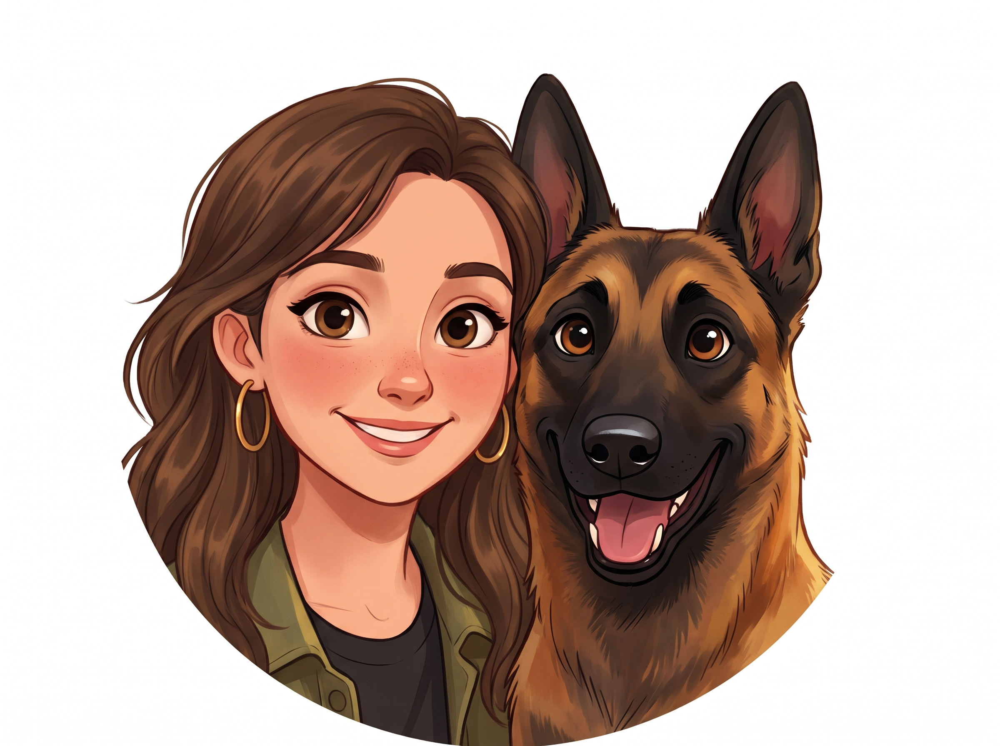

    

        <h1>Hi, I’m Rotem.</h1>
        Welcome to my corner of the web
    

    

## ABOUT ME

I’m a PhD student in [Prof. Deborah Fass’s lab](https://www.weizmann.ac.il/csb/Fass/home) in the Department of Chemical and Structural Biology at the [Weizmann Institute of Science](https://www.weizmann.ac.il/).

My academic path began at Ben-Gurion University of the Negev, where earning my B.Sc. and M.Sc. in Biotechnology Engineering sparked a deep curiosity that led me into structural biology and biophysics.

---

## MY SCIENCE WORLD

My doctoral research explores the fascinating world of **mucins**—the heavily glycosylated proteins that form the protective mucus hydrogel barriers in our bodies, as well as protein disulfide mechanisms.

Specifically, I investigate how densely packed sugar chains (O-glycosylation) and amino acid sequences shape the structure and conformational dynamics of mucin PTS regions (such as MUC2, MUC5AC, and MUC5B).

To look at these molecules up close, I combine **single-molecule FRET (smFRET)** measurements (in collaboration with [Prof. Hagen Hofmann's group](https://www.weizmann.ac.il/csb/Hofmann/home)) with structural visualization and computational tools.

🔬 smFRET
🧬 Protein Biophysics
🐍 Python
💻 C++
🧪 PyMOL & ChimeraX

<em>Course Goal:</em> My goal for this course is to acquire AI-driven computational tools to analyze quantitative data, enabling me to model and predict peptide behavior based on sequence.

---

## MY WORLD OUTSIDE

When I step away from the lab, here is how I love spending my time:

    

        <h3>🧘‍♀️ Yoga & Mindfulness</h3>
        
Unwinding on the mat to recharge, build strength, and find balance after long days of experiments.

    

    

        <h3>📚 Reading</h3>
        
Getting lost in a great book whenever I have a quiet moment with a cup of coffee.

    

    

        <h3>🐕 Life with Bruno</h3>
        
Going on daily walks, runs, and outdoor adventures with my energetic Belgian Malinois, Bruno.

    

---

## LET’S CONNECT

Feel free to reach out for research collaborations or just to say hi!

* ✉️ [rotem.azulay@weizmann.ac.il](mailto:rotem.azulay@weizmann.ac.il)
* 💼 [LinkedIn Profile](https://www.linkedin.com/in/rotem--azulay)
* 🏛️ [The Fass Lab](https://www.weizmann.ac.il/csb/Fass/home)
